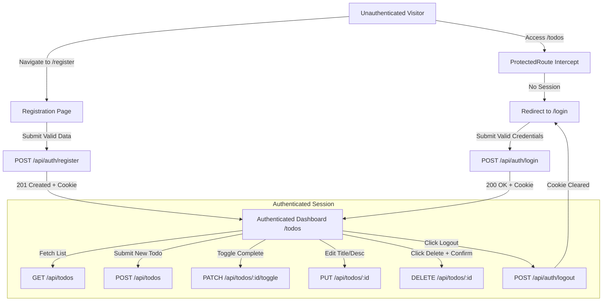

# Application Inventory: PERN Todo Application

**Document Version**: 1.0.0
**Author**: Senior QA Engineer / Test Architect
**Scope**: Exact implementation analysis of the existing codebase (`client/`, `server/`, `server/schema.sql`).

---

## 1. Frontend Architecture, Pages & Components

### 1.1 Routing Structure (`client/src/App.jsx`)
| Route Path | Component / Page | Access Control | Behavior / Redirection |
|---|---|---|---|
| `/register` | `<Register />` | Public | Displays registration form. On success, sets user state, writes `pern_todo_session` flag to `localStorage`, navigates to `/todos`. |
| `/login` | `<Login />` | Public | Displays login form. On success, sets user state, writes `pern_todo_session` flag to `localStorage`, navigates to `/todos`. |
| `/todos` | `<ProtectedRoute><Todos /></ProtectedRoute>` | Protected | Requires authenticated session. If `loading`, shows spinner; if unauthenticated, redirects to `/login` via `<Navigate to="/login" replace />`. |
| `*` (Catch-all) | `<Navigate to="/todos" replace />` | Dynamic | Wildcard fallback routing directly to `/todos` (which bounces to `/login` if unauthenticated). |

---

### 1.2 Frontend Pages Inventory

#### 1. `<Register />` (`client/src/pages/Register.jsx`)
- **Container**: Card (`.auth-page .card.auth-card`), heading `Create account`, subtitle `Join to manage your todos`.
- **Form Elements**:
  - `input#name` (`type="text"`, `maxLength={50}`, `autoComplete="name"`)
  - `input#email` (`type="email"`, `autoComplete="email"`)
  - `input#password` (`type="password"`, `maxLength={72}`, `autoComplete="new-password"`)
  - `input#confirmPassword` (`type="password"`, `maxLength={72}`, `autoComplete="new-password"`)
  - Submit Button: `button.btn.btn-primary.btn-full` with text `Create account` (displays `.spinner` and `disabled={loading}` during flight).
- **Feedback & Validation Elements**:
  - Inline field errors: `p.field-error` under each input; input border changes to `.error`.
  - Server-level alert: `div.alert.alert-error` rendered above the form.
  - Navigation Link: `p.auth-link` with `<Link to="/login">Log in</Link>`.

#### 2. `<Login />` (`client/src/pages/Login.jsx`)
- **Container**: Card (`.auth-page .card.auth-card`), heading `Welcome back`, subtitle `Log in to your account`.
- **Form Elements**:
  - `input#email` (`type="email"`, `autoComplete="email"`)
  - `input#password` (`type="password"`, `autoComplete="current-password"`)
  - Submit Button: `button.btn.btn-primary.btn-full` with text `Log in` (displays `.spinner` and `disabled={loading}` during flight).
- **Feedback & Validation Elements**:
  - Inline field errors: `p.field-error` under inputs; input border changes to `.error`.
  - Server-level alert: `div.alert.alert-error` (e.g. for `Invalid email or password`).
  - Navigation Link: `p.auth-link` with `<Link to="/register">Register</Link>`.

#### 3. `<Todos />` (`client/src/pages/Todos.jsx`)
- **Header**: Embedded `<Navbar />`.
- **Container**: `.container.todos-page` with heading `<h1>My Todos</h1>`.
- **Add Todo Card (`.card.add-todo-card`)**:
  - Title Input: `input[type="text"][placeholder="What do you need to do?"][maxLength=100]`
  - Submit Button: `button.btn.btn-primary` with text `Add` (`disabled={adding}`).
  - Description Toggle: `button.add-todo-toggle` toggles between `+ Add description` and `– Hide description`.
  - Description Textarea: `textarea[rows=2][placeholder="Optional description…"][maxLength=500]` (conditionally rendered).
  - Feedback Alerts: `div.alert.alert-error` for creation failure; inline `p.field-error` for title/description constraints.
- **Action Error Banner**: Dismissible `div.alert.alert-error` for toggle/delete operation failures with a `×` dismiss button.
- **List States**:
  - Loading State: `.state-msg` containing `.spinner` and text `Loading todos…`.
  - Fetch Error State: `.state-msg` with `div.alert.alert-error` and `button.btn.btn-ghost.btn-sm` (`Retry`).
  - Empty State: `.state-msg` with text `No todos yet — add one above! 👆`.
  - Populated State: `.todo-list` rendering collection of `<TodoItem />` components.

---

### 1.3 Reusable Components Inventory

#### 1. `<Navbar />` (`client/src/components/Navbar.jsx`)
- **Branding**: `<Link to="/todos" className="brand">✅ Todo App</Link>`.
- **User Session Display**: When `user` is non-null:
  - User greeting: `Hi, {user.name}`.
  - Logout trigger: `button.btn.btn-ghost.btn-sm` calling `logout()`.

#### 2. `<ProtectedRoute />` (`client/src/components/ProtectedRoute.jsx`)
- Consumes `useAuth()`.
- If `loading === true`: Renders `.state-msg` with spinner.
- If `user === null`: Returns `<Navigate to="/login" replace />`.
- If `user !== null`: Renders `children`.

#### 3. `<TodoItem />` (`client/src/components/TodoItem.jsx`)
- **Standard View**:
  - Container: `.todo-item` (appends `.completed` if `todo.is_completed === true`).
  - Checkbox: `input[type="checkbox"].todo-checkbox` with `aria-label="Toggle complete"`.
  - Title: `.todo-title` displaying `todo.title`.
  - Description: `.todo-desc` displaying `todo.description` (if present).
  - Actions: Edit button (`✏️`) with `aria-label="Edit"`; Delete button (`🗑️`) with `aria-label="Delete"`.
- **Inline Edit View**:
  - Form: `form.edit-form` (`noValidate`).
  - Title input: `input#edit-title-{id}` (`maxLength={100}`).
  - Description textarea: `textarea#edit-desc-{id}` (`rows={2}`, `maxLength={500}`).
  - Controls: `Save` button (`disabled={saving}`, `.spinner` active), `Cancel` button (restores original values).
  - Error feedback: Inline `p.field-error` and server `div.alert.alert-error`.

---

### 1.4 State & Session Management (`client/src/context/AuthContext.jsx`)
- **Storage Hint**: Non-sensitive key `pern_todo_session = "1"` in `localStorage`.
- **Mount Verification**:
  - If `hasSessionHint() === false`: `loading` set to `false` immediately; zero network calls.
  - If `hasSessionHint() === true`: Invokes `getMe()` (`GET /api/auth/me`). On 401/error, clears hint via `markLoggedOut()` and resets user state to `null`.
- **Logout Execution**: Calls `POST /api/auth/logout`, clears local storage flag, resets `user` state to `null`.

---

## 2. Backend API Endpoint Inventory

| HTTP Method | Route Path | Controller Function | Auth Required | Validation Middleware | Description |
|---|---|---|---|---|---|
| `GET` | `/health` | Inline handler | No | None | System liveness probe returning `{ status: "ok" }`. |
| `POST` | `/api/auth/register` | `register` | No | `registerValidators`, `validate` | Validates inputs, hashes password with bcrypt (cost 12), creates user, signs JWT, sets httpOnly cookie, returns `{ user: { id, name, email, createdAt } }`. |
| `POST` | `/api/auth/login` | `login` | No | `loginValidators`, `validate` | Validates email/password presence, compares bcrypt hash, signs JWT, sets httpOnly cookie, returns user object. Generic 401 on failure. |
| `POST` | `/api/auth/logout` | `logout` | No | None | Clears `token` cookie with matching SameSite/Secure attributes, returns `{ message: "Logged out" }`. |
| `GET` | `/api/auth/me` | `me` | Yes (`authMiddleware`) | None | Decodes JWT cookie, queries user by `id`, returns `{ user: { id, name, email, createdAt } }`. 401 if token missing/invalid. |
| `GET` | `/api/todos` | `getTodos` | Yes (`authMiddleware`) | None | Queries `todos` filtering by `user_id = req.userId` ordered by `created_at DESC`. Returns `{ todos: [...] }`. |
| `POST` | `/api/todos` | `createTodo` | Yes (`authMiddleware`) | `createTodoValidators`, `validate` | Validates title and optional description, inserts into `todos` with `user_id = req.userId`. Returns 201 `{ todo: {...} }`. |
| `PUT` | `/api/todos/:id` | `updateTodo` | Yes (`authMiddleware`) | `updateTodoValidators`, `validate` | Validates `:id` is positive integer, updates `title` and `description` where `id = $3 AND user_id = $4`. Returns 200 `{ todo: {...} }` or 404. |
| `PATCH` | `/api/todos/:id/toggle` | `toggleTodo` | Yes (`authMiddleware`) | `todoIdValidator`, `validate` | Toggles `is_completed = NOT is_completed` where `id = $1 AND user_id = $2`. Returns 200 `{ todo: {...} }` or 404. |
| `DELETE` | `/api/todos/:id` | `deleteTodo` | Yes (`authMiddleware`) | `todoIdValidator`, `validate` | Deletes row where `id = $1 AND user_id = $2`. Returns 200 `{ message: "Todo deleted" }` or 404. |
| `ALL` | Catch-all unknown routes | `notFound` | No | None | Returns 404 `{ errors: [{ message: "Route <METHOD> <PATH> not found" }] }`. |

---

## 3. Database Schema & Data Integrity Inventory

### 3.1 Table: `users`
| Column Name | Data Type | Nullable | Constraints & Defaults | Description |
|---|---|---|---|---|
| `id` | `SERIAL` | `NOT NULL` | `PRIMARY KEY` | Auto-incrementing unique user identifier. |
| `name` | `VARCHAR(50)` | `NOT NULL` | `CHECK (char_length(trim(name)) >= 2)` | User's display name (minimum 2 non-whitespace characters). |
| `email` | `VARCHAR(255)` | `NOT NULL` | `UNIQUE` | Normalized lowercase email address. |
| `password_hash` | `VARCHAR(255)` | `NOT NULL` | None | Bcrypt password hash (12 salt rounds). |
| `created_at` | `TIMESTAMPTZ` | `NOT NULL` | `DEFAULT NOW()` | Timestamp of record creation. |

### 3.2 Table: `todos`
| Column Name | Data Type | Nullable | Constraints & Defaults | Description |
|---|---|---|---|---|
| `id` | `SERIAL` | `NOT NULL` | `PRIMARY KEY` | Auto-incrementing unique todo identifier. |
| `user_id` | `INTEGER` | `NOT NULL` | `REFERENCES users(id) ON DELETE CASCADE` | Foreign key binding todo to owner. Deleting user cascades deletion. |
| `title` | `VARCHAR(100)` | `NOT NULL` | `CHECK (char_length(trim(title)) >= 1)` | Todo summary title (non-empty). |
| `description` | `VARCHAR(500)` | `YES` | None | Optional detailed description. |
| `is_completed` | `BOOLEAN` | `NOT NULL` | `DEFAULT FALSE` | Completion status flag. |
| `created_at` | `TIMESTAMPTZ` | `NOT NULL` | `DEFAULT NOW()` | Timestamp of record creation. |

### 3.3 Database Indexes
- `todos_user_id_idx` ON `todos(user_id)`: Optimizes user-filtered queries (`WHERE user_id = $1`).

---

## 4. Major Business Workflows

1. **User Registration Workflow**:
   - Client validates fields (`name` 2-50, `email` valid format, `password` 8-72 with >=1 letter and >=1 number, `confirmPassword` matching).
   - Server verifies duplicate email (409 Conflict if found), hashes password, creates user, issues signed JWT in `httpOnly` cookie (`token`), and returns user payload.
   - Client sets user state, writes `pern_todo_session` flag to `localStorage`, and navigates to `/todos`.

2. **User Login & Session Persistence**:
   - Client validates email and password presence.
   - Server checks email and compares bcrypt hash. Returns generic 401 `Invalid email or password` on any failure.
   - On success, sets 7-day `httpOnly` cookie (`token`).
   - Page refreshes consult `localStorage.getItem("pern_todo_session")`. If present, calls `GET /api/auth/me`. If cookie is valid, user is restored; if 401, flag is purged and user is redirected to `/login`.

3. **Todo Lifecycle & Ownership Isolation**:
   - **Creation**: Users create todos with mandatory title (1-100 characters) and optional description (max 500 characters). Todo is bound to `req.userId`.
   - **Listing**: Only todos where `user_id = req.userId` are returned, sorted newest first (`ORDER BY created_at DESC`).
   - **Editing**: Users can edit title and description inline. If a user attempts to edit a todo ID belonging to another user, query returns 404 `Todo not found`.
   - **Toggling**: Users click the checkbox to toggle completion status. Query enforces `user_id = req.userId`. Returns 404 if not found or unauthorized.
   - **Deletion**: Requires user confirmation via browser `window.confirm`. On confirmation, executes `DELETE FROM todos WHERE id = $1 AND user_id = $2`. Returns 404 if not found or unauthorized.
   - **Logout**: Clears cookie on server and client, purges session flag, and redirects to login.
