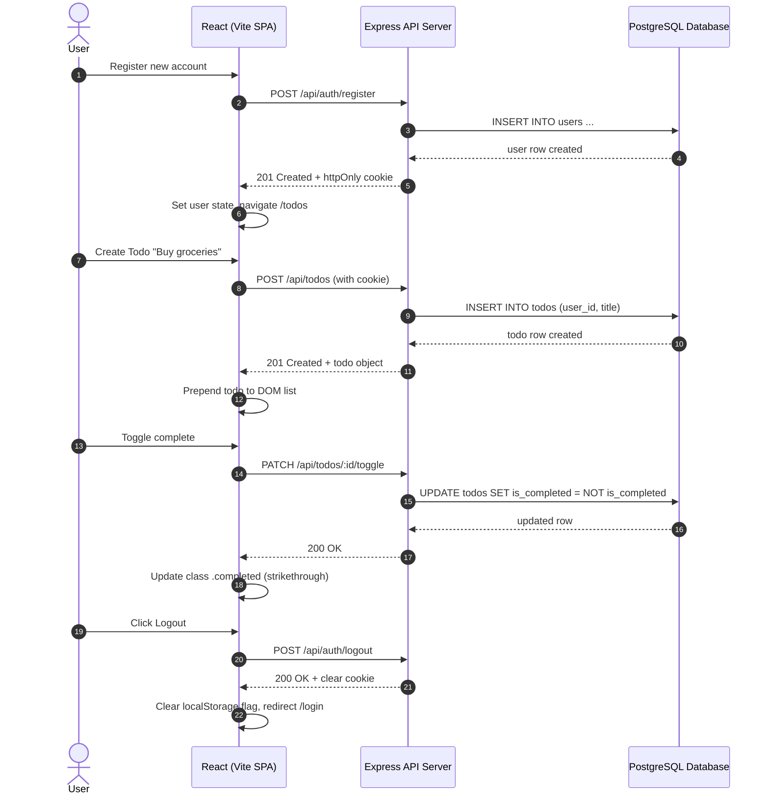

# End-to-End Integration Test Cases: PERN Todo Application

**Document Version**: 1.0.0
**Author**: Senior QA Engineer / Test Architect
**Scope**: Full-stack multi-tier integration (React Frontend <-> Express API <-> PostgreSQL Database)

---

## 1. Integration Test Flow Overview

---

## 2. End-to-End Integration Scenarios

### INT-TC-001: Complete User Lifecycle (Register -> Add Todos -> Edit -> Toggle -> Delete -> Logout)
- **Suite**: E2E Integration
- **Preconditions**: Backend and frontend running; database clean.
- **Test Steps**:
  1. Open browser to `/register`.
  2. Register with `name: "E2E Tester"`, email `e2e_{ts}@example.com`, password `Password123`.
  3. Verify automatic redirect to `/todos` and greeting `Hi, E2E Tester`.
  4. Create Todo 1: `Title: Buy groceries`, `Description: Fresh milk, organic eggs`.
  5. Create Todo 2: `Title: Book flight tickets` (no description).
  6. Verify both todos appear in the list in correct order (Todo 2 above Todo 1).
  7. Check database: execute `SELECT * FROM todos WHERE user_id = <new_user_id>;` and verify 2 rows exist.
  8. Click edit on Todo 1, change title to `Buy organic groceries`, click `Save`.
  9. Verify UI updates and database row reflects `Buy organic groceries`.
  10. Toggle Todo 2 to completed. Verify checkbox is checked, strikethrough applies, and database has `is_completed = true`.
  11. Click delete on Todo 2, accept confirmation dialog. Verify Todo 2 disappears from UI and database.
  12. Click `Logout`. Verify redirect to `/login`, cookie cleared, and `pern_todo_session` purged from `localStorage`.
  13. Attempt to navigate back to `/todos`. Verify instant redirect to `/login`.
- **Expected Outcome**: Entire multi-step user lifecycle succeeds cleanly across all 3 tiers.

---

### INT-TC-002: Dual-User Multi-Tenant Boundary Enforcement
- **Suite**: E2E Integration / Security
- **Preconditions**: Two clean user accounts (`User A` and `User B`).
- **Test Steps**:
  1. In Browser Context A, register and log in as `User A`.
  2. Create Todo: `User A Private Secret Note`.
  3. Obtain the generated Todo ID from network response (`id = A_ID`).
  4. In Browser Context B, register and log in as `User B`.
  5. Inspect User B's dashboard: verify `User A Private Secret Note` is completely invisible.
  6. Using User B's active session, send HTTP requests directly to API:
     - `GET /api/todos`: Must not contain `A_ID`.
     - `PUT /api/todos/A_ID` with `{"title": "Compromised"}`: Must return 404 Not Found.
     - `PATCH /api/todos/A_ID/toggle`: Must return 404 Not Found.
     - `DELETE /api/todos/A_ID`: Must return 404 Not Found.
  7. In Browser Context A, refresh page. Verify User A's todo remains completely untouched.
- **Expected Outcome**: Total data and action isolation between tenants. Foreign IDs return 404 without leaking presence.

---

### INT-TC-003: Session Expiration & Cold Recovery Workflow
- **Suite**: E2E Integration
- **Preconditions**: User logged in on `/todos`.
- **Test Steps**:
  1. User is viewing their todo list.
  2. In developer tools / server, simulate session expiration by manually clearing the `token` cookie while leaving `localStorage.pern_todo_session = "1"`.
  3. Refresh the page (`F5`).
  4. Observe application behavior:
     - `AuthContext` sees `pern_todo_session`, calls `GET /api/auth/me`.
     - Server returns 401 Unauthorized.
     - `AuthContext` catches error, calls `markLoggedOut()`, sets `user = null`.
     - `<ProtectedRoute>` redirects to `/login`.
     - `localStorage` flag is verified removed.
- **Expected Outcome**: Clean recovery and redirection without infinite loading spinner or unhandled UI exceptions.

---

### INT-TC-004: Network Disruption & Retry Recovery
- **Suite**: E2E Integration / Resilience
- **Preconditions**: User logged in on `/todos`.
- **Test Steps**:
  1. Intercept network route `GET /api/todos` using Playwright: `route.abort('failed')`.
  2. Refresh `/todos`.
  3. Verify UI displays error container: `div.alert.alert-error` with message and a `Retry` button.
  4. Un-abort the network route (`route.continue()`).
  5. Click `Retry` button.
  6. Verify spinner activates and todos are successfully fetched and rendered.
- **Expected Outcome**: Network failures present an informative message with a working retry trigger.
